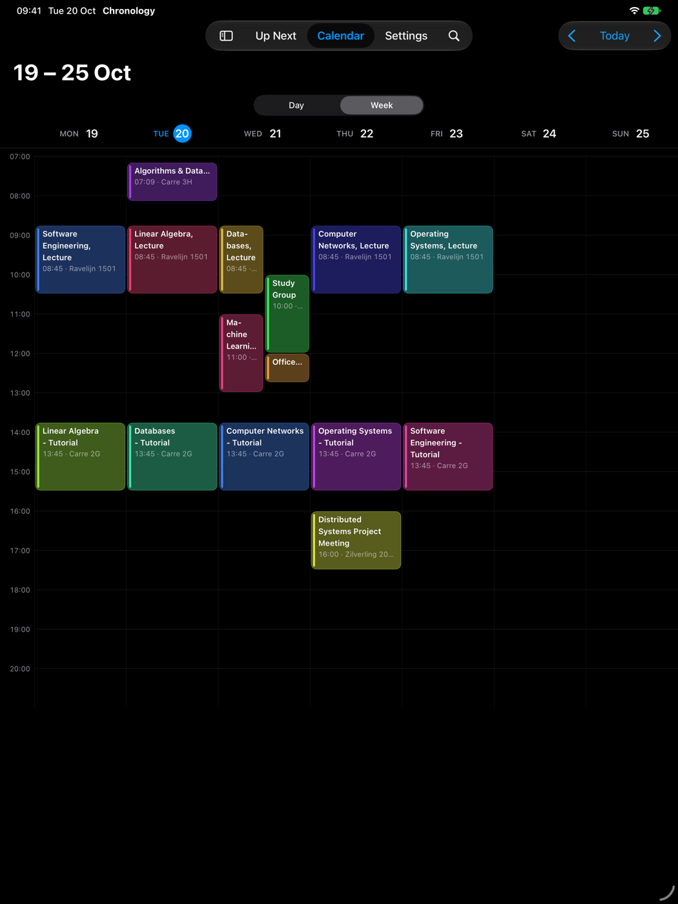
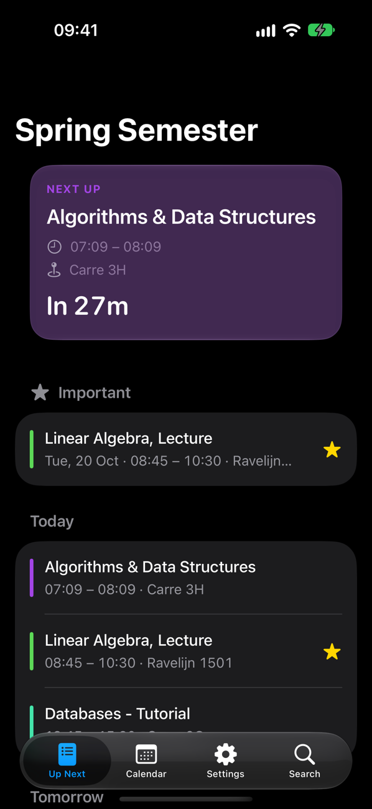
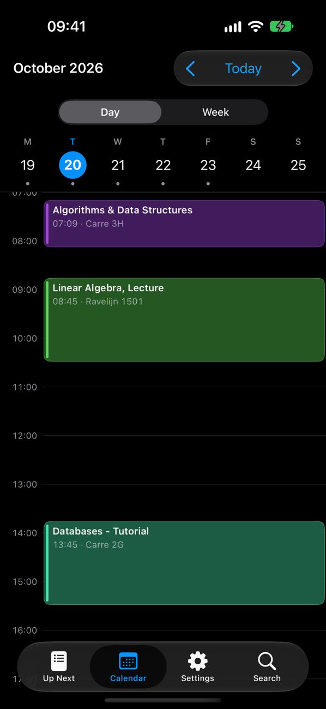

<p align="center">
  
</p>

<h1 align="center">Chronology</h1>

<p align="center">
  Your TimeEdit class schedule in the macOS menu bar, and on iPhone and iPad.
</p>

<p align="center">
  <a href="https://github.com/js-surya/Chronology/releases/latest"></a>
  <a href="https://github.com/js-surya/Chronology/actions/workflows/ci.yml"></a>
  
  
  
  <a href="LICENSE"></a>
</p>

Subscribe to a TimeEdit iCal URL, see your next class in the menu bar, and browse week and day views in a native SwiftUI window. A companion iPhone and iPad app adds a countdown, widgets and a Live Activity.

## Screenshots

<p align="center">
  
  
  
</p>

## Features

- **Menu bar countdown** — next class + time remaining ("In 15m", "Ends in 45m")
- **Week & Day views** — custom visible hour range
- **Multiple profiles** — unlimited iCal URLs, per-profile icon & color
- **Notifications** — configurable lead time (5m / 15m / 30m / 1h), mark events important
- **Per-course colors** — pick from curated palettes or custom
- **Personal notes** — attach notes to any event
- **Themes** — Light / Dark / AMOLED black, 7 accent presets + custom color, 12/24h time
- **Privacy** — no accounts, no analytics, no Chronology server; data stays on your devices (optional iCloud sync when built with a developer team)
- **Launch at login**, menu-bar-only mode

## Requirements

- macOS 26.0 (Tahoe)+ for the Mac app
- iOS / iPadOS 26.0+ for the iPhone & iPad app
- Xcode 26+ (only if building from source)

## Install

**Mac:** download `Chronology.dmg` from [Releases](https://github.com/js-surya/Chronology/releases) → open → drag to `/Applications`.

**iPhone & iPad (unsigned):** download `Chronology-iOS-*-unsigned.ipa` from the `ios-v*` release and install it with a sideloading tool such as [AltStore](https://altstore.io) or [Sideloadly](https://sideloadly.io), which signs it with your own Apple ID. With a free Apple ID the app must be refreshed every 7 days. iCloud sync isn't available in this build.

## Build from source

```bash
git clone https://github.com/js-surya/Chronology.git
cd Chronology
sh package_app.sh
```

Output: `Chronology.dmg` in project root.

Tests (shared core): `swift test`

### iPhone & iPad

```bash
open iOS/ChronologyMobile.xcodeproj
```

Pick the **ChronologyMobile** scheme and a simulator or device. To run on a device, set your team under *Signing & Capabilities* for both the app and the **ChronologyWidgets** extension (they share the App Group `group.com.codingpasanga.chronology`). The project is generated from `iOS/project.yml` with [XcodeGen](https://github.com/yonaskolb/XcodeGen) — run `xcodegen generate` in `iOS/` after adding files.

iCloud sync between the Mac and iOS apps is built in but needs a paid Apple Developer Program team to switch on — see [docs/ICLOUD_SETUP.md](docs/ICLOUD_SETUP.md).

The iOS app has Up Next (countdown + agenda), a day timeline (iPhone) / week grid (iPad), search, event notes, colors and important reminders, plus a **Next Up** widget for the Home and Lock Screen and a **Live Activity** in the Dynamic Island for the current or next class (can be turned off in Settings).

## Usage

1. Launch → **Create Profile** → paste TimeEdit iCal URL → pick icon + color.
2. Menu bar shows next class. Click icon for today's schedule.
3. `⌘,` for settings: appearance, hours, notifications, reminders.

Find your iCal URL on your TimeEdit schedule page → **Subscribe / Export** → copy the `.ics` link.

## Limitations

- iCal URL must be public (no auth)
- TimeEdit format only (other providers untested)

## Stack

Swift · SwiftUI · Liquid Glass · UserNotifications · WidgetKit · AppKit (menu bar). Shared logic lives in the `ChronologyCore` Swift package used by both apps. No third-party dependencies.

## Contributing

Bug reports, ideas and pull requests are welcome. See [CONTRIBUTING.md](CONTRIBUTING.md) to get started, and the [CHANGELOG](CHANGELOG.md) for what's new. Please follow the [Code of Conduct](CODE_OF_CONDUCT.md), and report security issues privately as described in [SECURITY.md](SECURITY.md).

## License

MIT — see [LICENSE](LICENSE).

Made by Surya with AI assistance.
